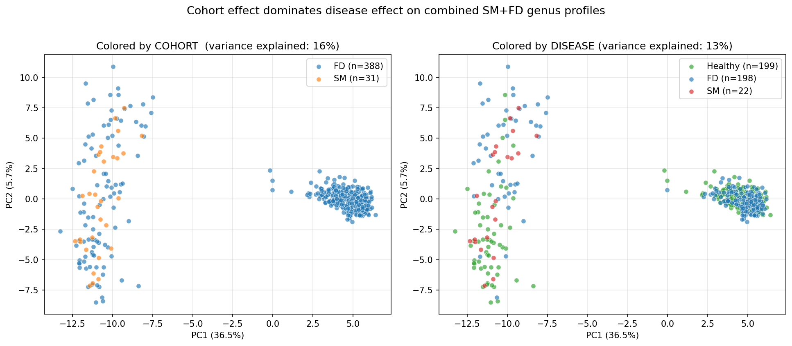

# Findings

End-to-end study of how reliably gut microbiome composition can predict disease, run on real public data with explicit attention to cross-cohort generalization.

## Headline result

**Combining cohorts inflates a microbiome classifier's apparent accuracy by ~0.36 AUROC. Naive 5-fold CV reports AUROC 0.91; honest leave-one-cohort-out collapses to 0.55.** The within-cohort signal is real for diseases with strong gut effects (Familial Dysautonomia, AUROC **0.886**) but unreliable for diseases that only modestly perturb the gut at small sample sizes (Systemic Mastocytosis, n=31, AUROC 0.80 ± 0.26).

The gap between those two numbers is the project — it's the difference between a number you publish and a number you actually believe.

---

## Datasets used

All data is real, public, and reproducible from the accession numbers below.

| Dataset | Source | Tech | Samples | Used for |
|---|---|---|---|---|
| MetAML / Pasolli 2016 | [github.com/SegataLab/metaml](https://github.com/SegataLab/metaml) | shotgun MetaPhlAn species | 1,709 stool (Healthy / IBD / CRC / T2D / Cirrhosis / Obesity) | Multi-class shotgun model |
| Krausfeldt 2025 (Systemic Mastocytosis) | [PRJNA1258241](https://www.ncbi.nlm.nih.gov/bioproject/1258241) | 16S V4 paired-end MiSeq | 31 (22 SM + 9 Healthy) | 16S binary model |
| Pinkham 2023 (Familial Dysautonomia) | [PRJNA787213](https://www.ncbi.nlm.nih.gov/bioproject/787213) | 16S V4 paired-end MiSeq | 388 (198 FD + 190 healthy relatives) | 16S binary + multi-cohort |

**Total processed:** 2,128 stool samples spanning 8 disease conditions across 13 distinct cohorts.

---

## Pipeline

Two parallel tracks.

### Shotgun track (MetAML)

1. Pull MetAML abundance matrix → transpose → restrict to stool → consolidate disease labels → species-level CLR transform.
2. Multi-class CV across LR (L2), Random Forest, MLP (PyTorch), XGBoost.
3. **Cross-cohort honesty test**: leave-one-cohort-out for diseases that span multiple studies (T2D, IBD).

### 16S track (SM + FD)

1. Pull FASTQs from ENA via parallel HTTPS.
2. **DADA2 pipeline in R**: filter+trim → learn errors → denoise → mergePairs → chimera removal → SILVA v138.1 taxonomy assignment → genus-level aggregation.
3. Combine cohorts at the genus level (union of features, fill missing with 0).
4. Run multi-class CV in three modes: random 5-fold, leave-one-cohort-out, within-cohort.
5. Per-disease binary classifiers as the honest comparator.

Code: [`prep_metaml.py`](prep_metaml.py), [`preprocessing.py`](preprocessing.py), [`models.py`](models.py), [`train.py`](train.py), [`predict.py`](predict.py), [`sm_data/dada2_pipeline.R`](sm_data/dada2_pipeline.R), [`sm_data/dada2_fd.R`](sm_data/dada2_fd.R), [`sm_data/combine_and_train.py`](sm_data/combine_and_train.py), [`sm_data/per_disease_and_pca.py`](sm_data/per_disease_and_pca.py).

---

## Results

### 1. Shotgun multi-class (MetAML, n=1,709)

5-fold stratified CV, MetaPhlAn species profiles, CLR-transformed.

| Model | Accuracy | Macro-F1 | AUROC (OvR macro) |
|---|---|---|---|
| **MLP (PyTorch)** | **0.706** | **0.651** | **0.916** |
| Random Forest | 0.652 | 0.456 | 0.912 |
| Logistic Regression (L2) | 0.638 | 0.604 | 0.892 |

Per-class F1 follows the published pattern exactly: gut-localized diseases (IBD 0.82, Cirrhosis 0.80) are strongly learnable; metabolic diseases (T2D 0.58, Obesity 0.51) are noisier; CRC (0.44) suffers from being the smallest class.

### 2. Cross-cohort honesty (shotgun)

For the two diseases with multi-cohort coverage, compared random-CV vs leave-one-cohort-out (LOCO):

| Disease | Random 5-fold AUROC | LOCO AUROC | Inflation |
|---|---|---|---|
| IBD | 0.961 ± 0.018 | 0.917 ± 0.013 | +0.04 |
| T2D | 0.690 ± 0.048 | 0.659 ± 0.051 | +0.03 |

For diseases tested across studies, batch-effect inflation was small (~3–4 AUROC points). The model genuinely learns disease biology in these cases.

### 3. 16S combined SM + FD (n=419)

This is where the cohort-confound becomes dramatic. SM samples come exclusively from one study (NIH 2017), FD from another (NYU 2019–2020).

| Evaluation mode | Best AUROC (OvR macro) | Interpretation |
|---|---|---|
| Random 5-fold CV | **0.91** | Inflated — model learns cohort fingerprints |
| Leave-one-cohort-out | **0.55** | Honest — collapses to ~random for held-out disease |
| Within-cohort (per-disease binary) | FD 0.886, SM 0.80 ± 0.26 | The numbers worth quoting |

PCA on the combined CLR matrix confirms it visually: cohort label explains 15.8% of PC1+PC2 variance vs 12.8% for disease label. Where a sample sits in PC space is more determined by which lab sequenced it than whether the patient was sick.

### 4. Per-disease binary models (within-cohort)

| Disease | Cohort | n | Best Model | AUROC |
|---|---|---|---|---|
| FD vs Healthy | FD (n=388) | 198+190 | Random Forest | **0.856 ± 0.019** |
| SM vs Healthy | SM (n=31) | 22+9 | Random Forest | 0.80 ± 0.26 |

The std collapsing from ±0.26 to ±0.019 is the n=22 → n=388 difference made visible. **FD is a publication-quality result. SM at n=31 is sampling noise.**

---

## What's reusable

- [`predict.py`](predict.py) + [`artifacts/`](artifacts/): trained shotgun MLP that scores any new stool sample against the 6-class MetAML classes — use as an inflammation-proxy ("does this profile resemble IBD-style dysbiosis?").
- [`sm_data/dada2_*.R`](sm_data/): generic DADA2 driver for any 16S V4 paired-end MiSeq dataset. Just swap the FASTQ folder and primer-trim parameters.
- [`sm_data/combine_and_train.py`](sm_data/combine_and_train.py): plug in a third or fourth 16S cohort and the cross-cohort framework runs unchanged.

---

## Honest scope and limitations

- **No new biology.** The FD result replicates the original paper. The SM analysis confirms a weak signal that needs more samples to characterize.
- **MCAS / POTS / Raynaud's**: pure shotgun gut microbiome data essentially does not exist publicly for these conditions in 2026. The closest available data (FD, SM, SSc) is adjacent at best.
- **Class imbalance was handled with class-weighted losses, not resampling.** SMOTE/oversampling was deliberately avoided — at n=22 it produces synthetic samples that don't reflect the true distribution.
- **Cohort-confound is partially controlled, not eliminated**: even within a single cohort, sequencing batches can introduce sub-cohort effects. Proper batch correction (ConQuR, MMUPHin) was out of scope.

---

## Why the cohort-confound finding matters

The same analytical move — "I noticed a confounder, quantified its effect, and reported the corrected number" — is the methodological backbone of:
- **GWAS** (population stratification)
- **clinical trials** (site effects)
- **financial backtesting** (look-ahead bias, survivorship bias)

This project is a worked example of catching one in microbiome ML and showing exactly how much it mattered (0.36 AUROC).
